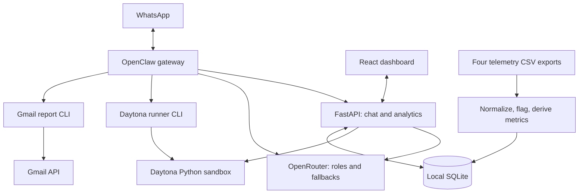

# AquaMind

AquaMind is a water-telemetry operations assistant with a WhatsApp interface and a web dashboard. It combines OpenClaw, OpenRouter model routing, a local SQLite analytics service, and Daytona sandboxes for Python execution. A Gmail tool can send incident reports when requested.

The project started with inconsistent consumption exports. I added a common event schema and quality flags so the assistant could work with comparable metrics rather than interpret each CSV differently. The dashboard exposes those metrics alongside model and sandbox output.

## Architecture



The WhatsApp gateway uses workspace instructions and command-line tools. The dashboard calls FastAPI directly. They share analytics endpoints but have separate chat and execution paths. [Detailed architecture](docs/ARCHITECTURE.md)

## Data and analytics

The four CSVs describe three customer profiles and a gym. Their columns, timestamps, and measurement conventions differ. ETL retains raw rows, maps them to a common event schema, flags suspect measurements, and builds daily profiles, device baselines, motifs, and anomaly candidates.

The API provides summaries, metrics, comparisons, motifs, anomalies, and read-only SQL. Quality-filtered views separate trusted measurements from rows needing review. Anomaly candidates are analysis outputs, not independently validated leak diagnoses. [SQLite design](docs/SQLITE_BACKEND.md), [data inventory](docs/DATA_INVENTORY.md), [interpretation rules](docs/AGENT_DATA_RULES.md)

## Models and code execution

OpenRouter calls use configurable roles and fallback chains. Backend defaults are Liquid LFM for chat, Qwen3 Next for planning, and MiniMax M2.5 for code. OpenClaw has a separate model-chain patch and latency-based provider selection. Check `.env` and `openclaw/aquamind.patch.json5` for configuration; model availability depends on the provider.

The dashboard's `POST /run` uses local intent heuristics. Short conversational requests get a model reply without a sandbox. Data/code requests generate Python, execute it in Daytona, and can retry with the execution error, up to three attempts. SSE events carry progress, model output, code, results, and charts to the frontend.

`backend/chat_data.py` implements a SQLite-first planner, but the current `/run` handler does not call it. Dashboard Insights and OpenClaw tools query SQLite through the REST endpoints. A chat reply should not be assumed to have read the database. [Frontend contract](frontend/README.md)

## Run the local analytics stack

The scripts target Windows PowerShell. Python and Node.js are needed for the backend and dashboard respectively.

```powershell
git clone https://github.com/MrenXX/AquaMind.git
cd AquaMind
Copy-Item .env.example .env
python -m venv .venv
.\.venv\Scripts\python.exe -m pip install -r requirements-backend.txt
.\.venv\Scripts\python.exe scripts\etl\build_database.py
.\.venv\Scripts\python.exe scripts\validate_db.py
.\scripts\start-aquamind-backend.ps1
```

The API runs at `http://127.0.0.1:8765`. `/docs` lists routes; `/health` reports database and model configuration. The generated `data/aquamind.sqlite` is ignored by Git and can be rebuilt from the CSVs.

In a second PowerShell terminal, from the repo root:

```powershell
cd frontend
npm ci
$env:VITE_CHAT_API = '/api'
npm run dev
```

Vite proxies `/api` to the backend. `VITE_ANALYTICS_API` can override the analytics endpoint. [Frontend setup](frontend/README.md)

Static analytics needs no model credentials. Chat requires `OPENROUTER_API_KEY`; sandbox requests also require `DAYTONA_API_KEY`. Weather enrichment is a separate optional network step.

## WhatsApp and reporting

Follow [the OpenClaw setup guide](openclaw/README-WHATSAPP.md) to install the gateway and WhatsApp plugin, apply configuration patches, link the account, and copy workspace templates.

```powershell
.\scripts\apply-openclaw-aquamind-patch.ps1
.\scripts\patch-whatsapp-allowlist.ps1
openclaw channels login --channel whatsapp
Copy-Item .\openclaw\workspace-templates\* "$env:USERPROFILE\.openclaw\workspace" -Force
.\scripts\start-watersec-openclaw-gateway.ps1
```

Review the allowlist and account settings before applying them. These patches modify the local OpenClaw configuration. The workspace templates are runtime instructions and tool contracts.

Gmail reporting uses `requirements-gmail.txt`, Google OAuth, sender/recipient settings, and a local send log. Tokens live outside the repo. The CLI accepts structured JSON on stdin and supports `--dry-run`. Sending a report is an explicit action, separate from database setup. [Tool instructions](openclaw/workspace-templates/TOOLS.md)

## Validation and limits

`scripts/validate_db.py` checks the warehouse. The frontend provides `npm run build` and `npm run lint`. WhatsApp, model calls, sandbox execution, and Gmail delivery also require their external services and credentials.

The included data supports the analytics demonstration. Routing is heuristic, sandbox retries are bounded, and the API targets local use. Keep `.env`, OAuth tokens, generated databases, and live account sessions out of commits. [MIT license](LICENSE)
