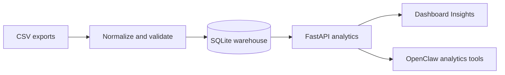

# Architecture

AquaMind has two entry points: an OpenClaw agent reached through WhatsApp, and a React dashboard backed by FastAPI. Both can use the telemetry API, while their chat and code-execution paths remain separate.

## Telemetry pipeline

Four CSV exports are loaded by `scripts/etl/build_database.py`. The pipeline keeps raw source rows, normalizes events, adds quality flags, and derives profiles, baselines, motif patterns, and anomaly candidates in `data/aquamind.sqlite`.

FastAPI exposes these results through `/dashboard/summary` and `/tools/*`. The dashboard's Insights tab calls the same analytics endpoints described to OpenClaw in the workspace tool instructions. Queries use the local warehouse rather than asking a language model to calculate from CSV text.



The database is generated output and is not committed. Rebuild it from the repository root:

```powershell
python scripts\etl\build_database.py
python scripts\validate_db.py
```

[Schema and cleaning](SQLITE_BACKEND.md), [source mapping](NORMALIZED_MAPPING.md), [interpretation rules](AGENT_DATA_RULES.md)

## WhatsApp agent

OpenClaw manages the WhatsApp session and the agent's workspace. The configuration patch defines its OpenRouter model chain, provider preference, timeouts, and channel behavior. Workspace templates define tool contracts and how to interpret the telemetry.

The agent can query the analytics API, run Python through `aquamind_daytona_runner_cli.py`, or request an incident report through `aquamind_gmail_report_cli.py`. The runners return structured JSON. Gmail additionally requires OAuth and records sends in a local SQLite log.

The gateway configuration and account credentials live under the user's OpenClaw directory. Repository patches are inputs to that configuration, not a copy of the live account session. [Bootstrap and operation](../openclaw/README-WHATSAPP.md), [tool contracts](../openclaw/workspace-templates/TOOLS.md)

## Dashboard chat

`POST /run` in `backend/chat.py` returns SSE events. Local heuristics in `backend/intent.py` select a fast, balanced, or heavy route:

1. Fast conversational requests call the chat model and return text without executing Python.
2. Other requests use the code-generation model chain to produce Python.
3. Daytona executes the code in a sandbox. The backend collects stdout and chart output, then deletes the sandbox.
4. A failed attempt can feed its code and execution error back to the model. The loop is limited to three attempts.

The frontend renders progress, model output, Python, sandbox results, repairs, and completion from the event stream. It uses `fetch` and a readable response stream because the request includes a POST body. [Event contract](../frontend/README.md)

### SQLite planner status

`backend/chat_data.py` implements a planner that selects a telemetry tool or guarded SQL, executes against SQLite, and can request a Daytona fallback. It is not wired into the current `/run` handler. Setting `AQUAMIND_CHAT_SQLITE_FIRST` does not enable it through that handler.

SQLite-backed Insights and direct analytics tools are available independently. A general chat or generated chart should not be described as database-grounded unless it was supplied the relevant query results.

## Model configuration

OpenClaw and FastAPI have separate model configuration paths. The OpenClaw JSON5 patch defines its primary and fallback chain. FastAPI uses chat, planner, and code roles from `backend/openrouter_client.py`, with environment overrides and retry/fallback behavior.

The `/health` response reports configured roles, heuristic routing, and database status. It does not prove that every configured provider is currently reachable. Per-request events identify the model used when a completion succeeds.

## Local services and external APIs

SQLite and FastAPI run locally. The Vite development server proxies `/api` to FastAPI on port 8765. OpenRouter handles model requests, Daytona handles sandbox execution, and Gmail handles requested email delivery.

Secrets stay in local environment files and OAuth storage. The API targets local use; CORS configuration and a read-only SQL guard do not replace authentication if it is exposed beyond the development machine.
